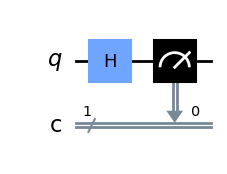

# Quantum Computing Fundamentals with Qiskit

Ce dépôt regroupe mes travaux pratiques, algorithmes et simulations en informatique quantique réalisés avec **Qiskit**.

---

##  Module 1 : Superposition Quantique & Porte de Hadamard

###  Objectif
Démontrer la création d'un état de superposition quantique à partir d'un qubit initialisé à $|0\rangle$, suivi d'une mesure statistique sur 1000 exécutions (*shots*).

###  Théorie & Concepts Mathématiques
La porte de Hadamard ($H$) transforme un état de base computational en une combinaison linéaire équilibrée :

$$H|0\rangle = \frac{|0\rangle + |1\rangle}{\sqrt{2}}$$

Lors de la mesure, le qubit s'effondre vers $|0\rangle$ ou $|1\rangle$ avec une probabilité théorique égale de 50%.

###  Implémentation & Schéma du Circuit
Voici à quoi ressemble le circuit généré par le script :



---

##  Installation & Exécution

```bash
git clone [https://github.com/PrincioCyriliot/quantum-computing-fundamentals.git](https://github.com/PrincioCyriliot/quantum-computing-fundamentals.git)
cd quantum-computing-fundamentals
pip install -r requirements.txt
python 01_superposition/superposition.py
```
 
 
 ## Module 2 : Intrication Quantique (État de Bell)

Création et simulation d'une paire de qubits intriqués dans l'état de Bell $|\Phi^+\rangle = \frac{|00\rangle + |11\rangle}{\sqrt{2}}$.

### Notions clés
- **Porte Hadamard ($H$)** : Place le premier qubit en superposition.
- **Porte CNOT ($CX$)** : Intrique le second qubit au premier.
- **Mesure et Simulation** : Utilisation de `AerSimulator` de Qiskit pour exécuter 1000 tirages (`shots=1000`).

### Code Python
Le script se trouve dans [`02_etanglement/bell_state.py`](./02_etanglement/bell_state.py).

### Résultats d'exécution
Les mesures donnent une répartition quasiment égale entre `00` et `11`, prouvant l'intrication des deux qubits :
- `'00'` : ~500 fois
- `'11'` : ~500 fois
